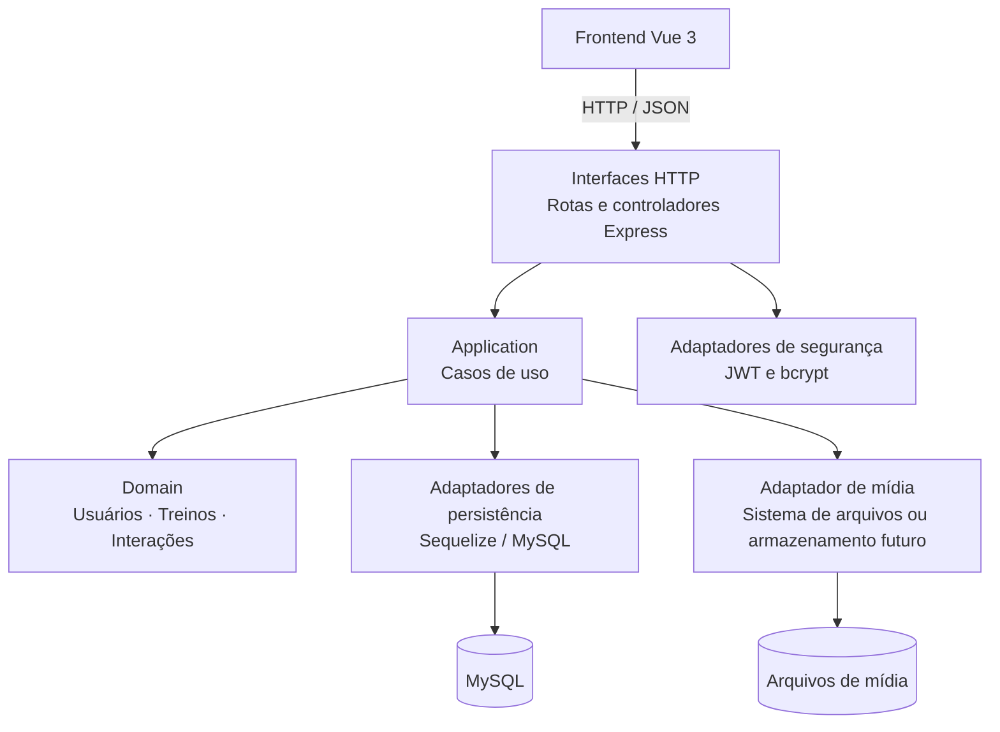

# Diagrama da arquitetura DDD proposta

O diagrama representa uma visão lógica em camadas para um monólito modular. Não representa infraestrutura de produção nem serviços já implementados.

## Leitura do diagrama

- O frontend consome a API HTTP.
- A interface HTTP valida/adapta requisições e encaminha operações aos casos de uso.
- Os casos de uso coordenam as regras do domínio e dependências técnicas por contratos.
- Os adaptadores de persistência e mídia implementam o acesso ao MySQL e aos arquivos.
- JWT e bcrypt são mecanismos técnicos; as políticas de autorização e os casos de uso devem ser organizados de forma que as regras de negócio não fiquem espalhadas por detalhes do framework.

A ligação do módulo de segurança é ilustrativa: a autenticação HTTP pode verificar a identidade antes de invocar um caso de uso, enquanto a autorização de negócio deve ser garantida no fluxo de aplicação/domínio apropriado.
