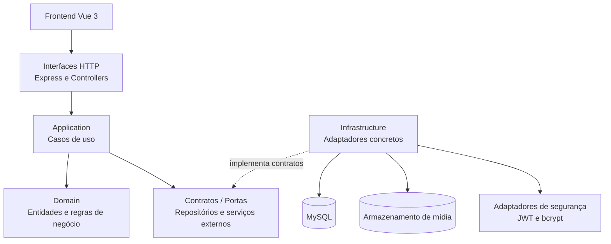

# Diagrama da Arquitetura DDD do FitTrack

O diagrama apresenta a arquitetura-alvo proposta para o FitTrack, organizada como um monólito modular baseado em Domain-Driven Design (DDD).

A camada de aplicação coordena os casos de uso e depende de contratos (portas) para acessar recursos externos. A infraestrutura implementa esses contratos, mantendo o domínio independente de tecnologias como Express, Sequelize e do sistema de arquivos.

## Interpretação do diagrama

- **Frontend:** interface web desenvolvida com Vue 3, responsável pela interação com o usuário.
- **Interfaces HTTP:** recebem as requisições e encaminham as operações para os casos de uso.
- **Application:** coordena os casos de uso, como publicar treinos, adicionar comentários e registrar curtidas.
- **Domain:** concentra o modelo de domínio e as regras de negócio, sem depender diretamente de frameworks ou tecnologias de persistência.
- **Contratos / Portas:** definem as operações necessárias para acessar repositórios e serviços externos.
- **Infrastructure:** fornece implementações concretas para persistência, armazenamento de mídia e segurança.
- **MySQL:** representa a persistência dos dados.
- **Armazenamento de mídia:** representa o mecanismo utilizado para guardar arquivos de treinos e imagens.
- **Adaptadores de segurança:** encapsulam os mecanismos técnicos de autenticação e hash de senhas.

## Regra de dependência

A aplicação depende de contratos definidos para suas necessidades, e a infraestrutura implementa esses contratos. Assim, é possível substituir detalhes técnicos sem obrigar o domínio a depender diretamente deles.

Este diagrama representa uma proposta de arquitetura-alvo. Ele não afirma que a separação completa em camadas e contratos já esteja implementada no código atual do FitTrack.
